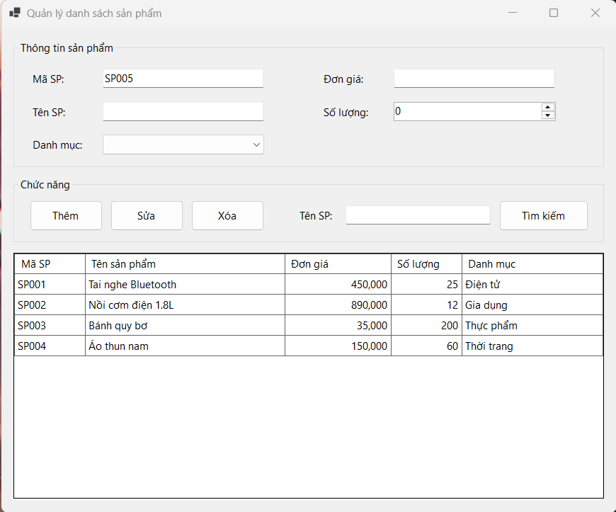
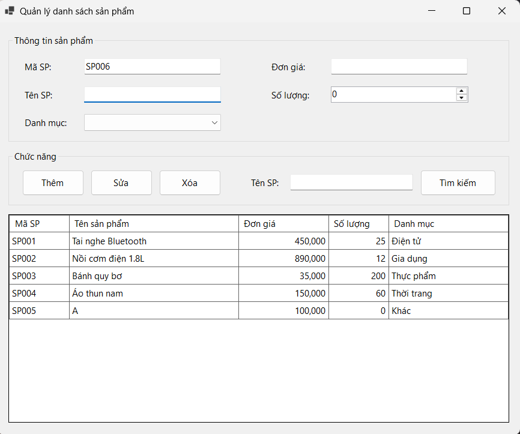
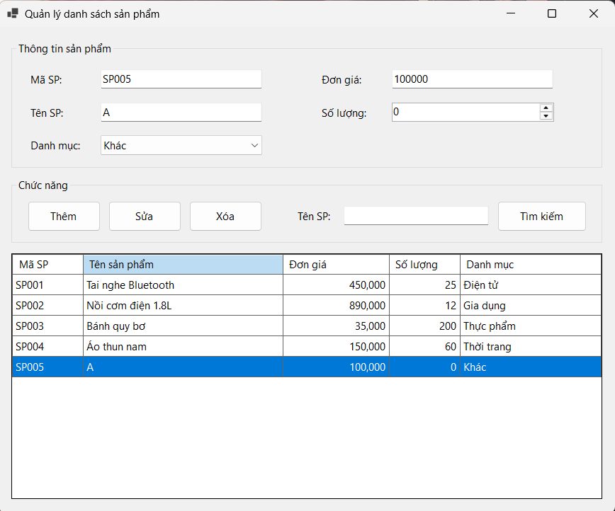
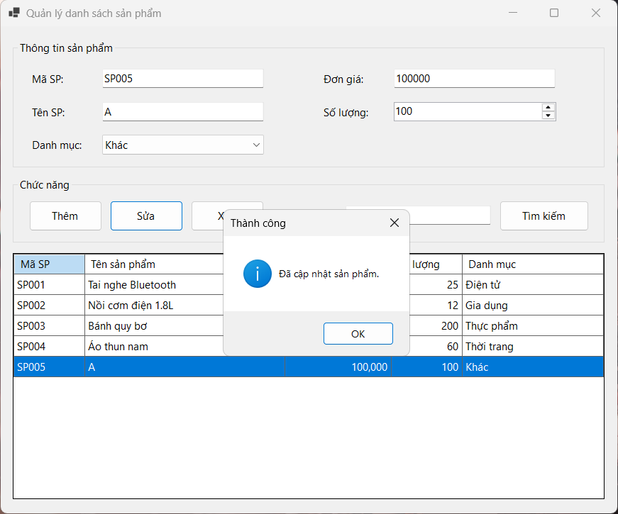
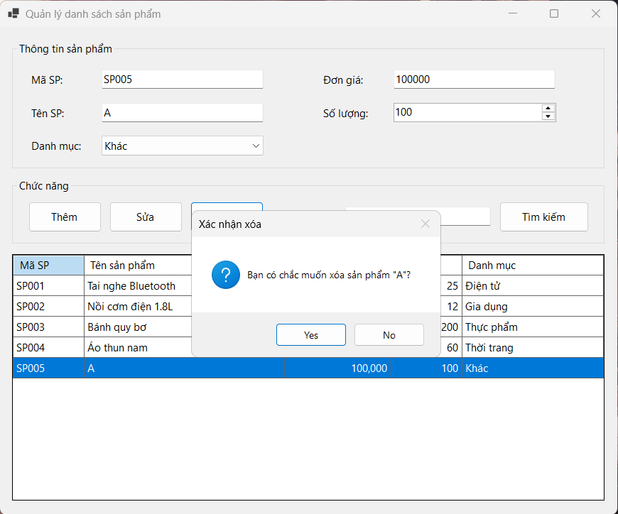
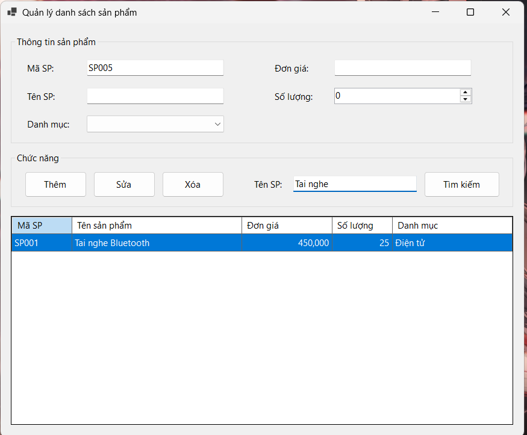
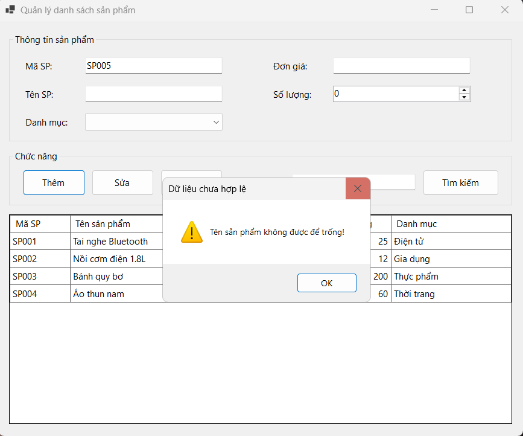
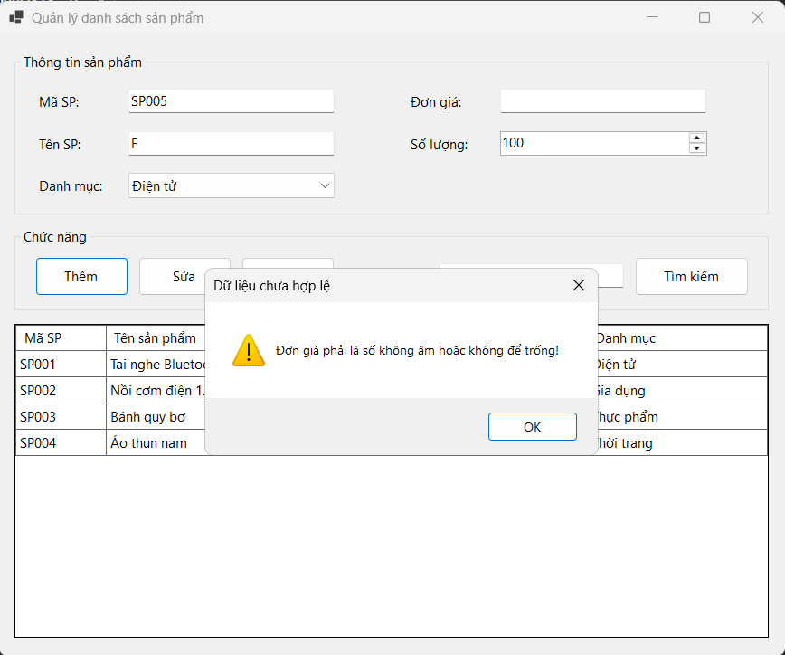
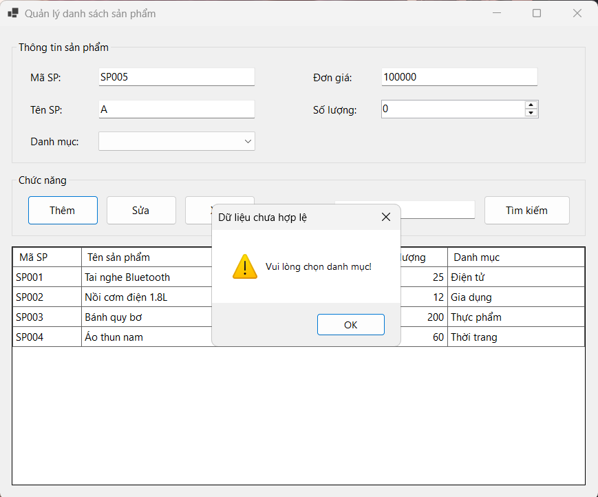

## THÔNG TIN SINH VIÊN 
- **Họ và tên:** Phạm Huy Hoàng
- **Mã số sinh viên:** 24810340415
- **Lớp:** D19CNPM3
- **Tên môn học:** Lập trình C# / Windows Forms 
- **Tên bài tập:** BÀI 5.3: FORM QUẢN LÝ DANH SÁCH SẢN PHẨM TRONG BỘ NHỚ (DATAGRIDVIEW CƠ BẢN)
--- 
## KẾT QUẢ THỰC HÀNH 
### 1. Ảnh màn hình Giao diện chính 
 

### 2. Ảnh màn hình Chức năng thực thi / Kết quả 
#### Thực thi chức năng thêm
 

---------
#### Thực thi chức năng chọn
 

---------
#### Thực thi chức năng cập nhật
 

---------

#### Thực thi chức năng xóa
 

---------
#### Thực thi chức năng tìm kiếm theo tên sản phẩm
 

---------
### 3. Ảnh màn hình Kiểm tra lỗi (Validation)
#### Kiểm tra lỗi không nhập tên sản phẩm

---------
#### Kiểm tra lỗi không nhập đơn giá 

---------
#### Kiểm tra lỗi không chọn danh mục

---------

